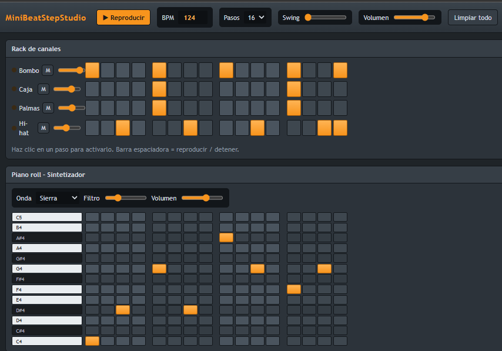

# 🎹 MiniBeatStepStudio


Estudio de beats en el navegador inspirado en  Digital Audio Workstations. Tiene un secuenciador de pasos para batería y un piano roll con sintetizador, y todo el sonido se genera con la Web Audio API, sin archivos de audio ni librerías externas.



## ✨ Características

- **Rack de canales** con 4 instrumentos de batería: bombo, caja, palmas y hi-hat.
- **Piano roll** de una octava (C4 a C5) con sintetizador propio.
- **Cantidad de pasos configurable:** 8, 16, 32, 48 o 64.
- **Controles de transporte:** reproducir y detener (también con la barra espaciadora), BPM de 60 a 200 y swing.
- **Mezcla básica:** volumen por canal, botón de silencio, volumen general y compresor en la salida.
- **Sintetizador ajustable:** onda (sierra, cuadrada, triángulo o seno), filtro y volumen.
- **Ritmo estable:** el secuenciador programa las notas con el reloj del audio, no con temporizadores de JavaScript.

## 🛠️ Tecnologías

| Tecnología | Uso |
|---|---|
| HTML5 | Estructura de la página |
| CSS3 | Diseño oscuro con variables CSS y flexbox |
| JavaScript (vanilla) | Estado, interfaz y secuenciador |
| Web Audio API | Generación de todos los sonidos |

## 🚀 Cómo ejecutarlo

No necesita instalación ni servidor.

1. Clona el repositorio o descarga los archivos:
   ```bash
   git clone https://github.com/Kiroz1/MiniBeatStepStudio.git
   ```
2. Abre `index.html` en tu navegador (Chrome, Edge o Firefox).
3. Haz clic en **Reproducir** o pulsa la barra espaciadora.

> El navegador solo permite reproducir audio después de que hagas clic en algo de la página, por eso el sonido empieza al pulsar Reproducir.

## 🎛️ Cómo se usa

1. Haz clic en un paso del rack o del piano roll para activarlo o desactivarlo.
2. Cambia la cantidad de pasos con el selector **Pasos**.
3. Ajusta el **BPM** y el **Swing** a tu gusto.
4. Usa **Limpiar todo** para empezar con un patrón vacío.

## 📁 Estructura del proyecto

```
MiniBeatStepStudio/
├── capturas/        # Imágenes para el README
├── index.html       # Estructura de la página
├── style.css        # Estilos
├── script.js        # Lógica, audio y secuenciador
└── README.md
```


## 📜 Aviso y uso

Este proyecto es **solo para fines de prueba y estudio**. Eres libre de usarlo como base para tus propios proyectos, modificarlo y aprender con él.

## 👤 Autor

Hecho por [Kiroz1](https://github.com/Kiroz1).
